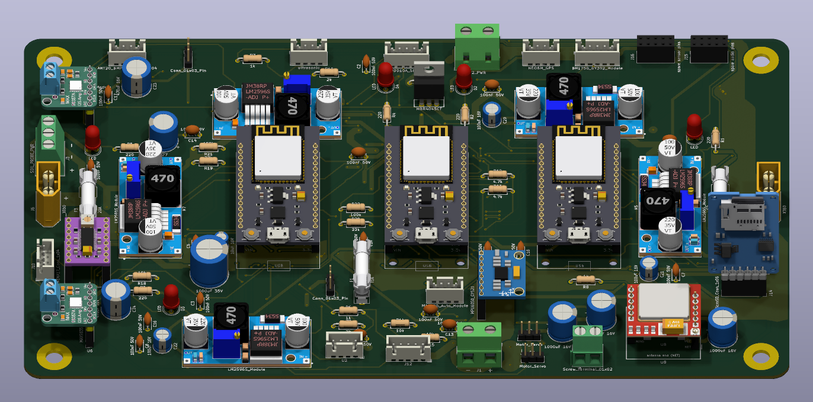
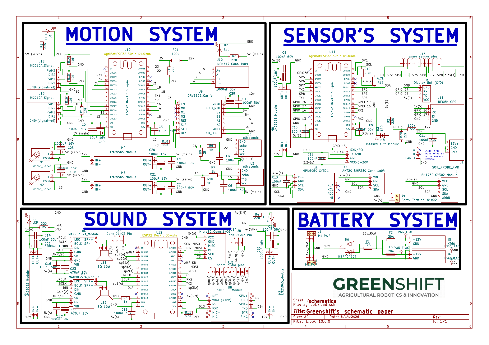
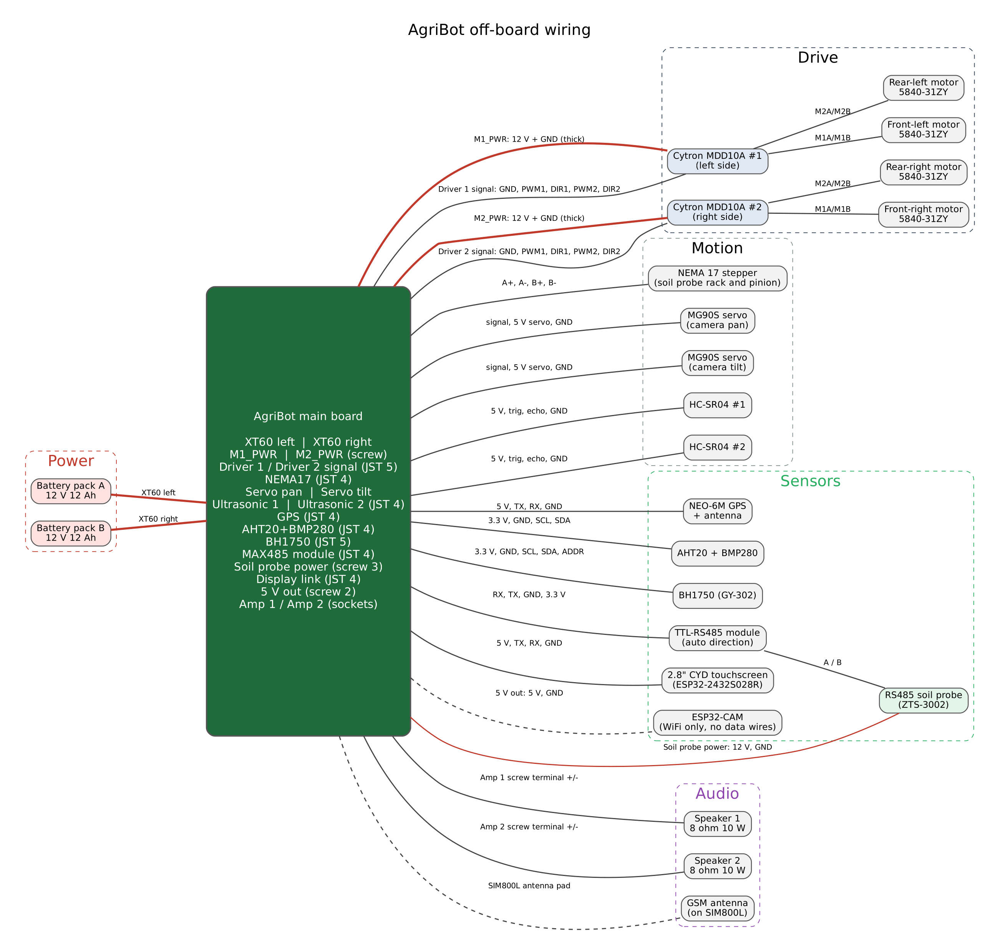

# The AgriBot rover

AgriBot is a farming rover with a top speed of 1.4 km/h, and this is the one board that runs all of it: three ESP32s, five buck converters, the motor driver links, a stepper that shoves a soil probe into the ground, GPS, a SIM800L and two speakers, all on 260 x 150 mm of 2 oz copper.

## How it's used

Your phone joins the WiFi network that the Sensors ESP32 puts up, then sends throttle and steering about 20 times a second over UDP. Sensors passes that down a UART to the Motion ESP32, and Motion mixes it into left and right wheel speeds for the two Cytron MDD10A motor drivers. The drivers live off the board. They get their signals over a JST cable and their 12 V from the two screw terminals marked M1_PWR and M2_PWR.

If Motion goes 150 ms without a packet, it stops the motors. That's the whole safety system. I skipped a real e-stop because you can walk faster than this thing, and pulling an XT60 turns everything off.

Video comes from an ESP32-CAM that isn't on this board. It joins the same WiFi and the phone pulls the stream straight from it. The two servo headers on the board are for its pan/tilt.

When you stop somewhere you want to test, a NEMA 17 on a rack and pinion pushes the RS485 soil probe into the ground and Sensors reads it. Sensors also reads temperature, humidity, pressure, light, GPS and an IMU, and sends data to a separate 2.8" touchscreen (the Cheap Yellow Display) over a 4-pin cable. The Audio ESP32 plays sounds off a microSD through two speakers and runs the SIM800L, so the rover can still text me when it's out of WiFi range.

Where it's at right now: the firmware folder is pin maps plus startup code that puts every pin in a safe state. The real driving code gets written when the boards show up.

## Why I made it

I took AgriBot to RobotChallenge in Beijing this August and came 4th in FreeStyle Senior. Back then it was an autonomous competition robot. Once that was done I wanted something dumber and way more fun: drive it around from my phone like an RC car, with a camera feed.

The plan before this was three separate boards (Motion, Sensors, Audio) talking to each other over ESP-NOW. I wanted the chips wired together instead of over radio, so everything went onto one board. It still needs three ESP32s though. I counted around 39 GPIOs for everything on here and one DevKit gives you about 24 usable ones, so the three chips are linked over UART with Sensors in the middle.

The weirdest call on the board is that the SIM800L hangs off the Audio ESP32 and not Sensors, where it obviously belongs. Each ESP32 only has two free hardware UARTs (the third one is the USB port), and Sensors already spends both of them on Motion and Audio. Audio was using 10 pins and doing nothing most of the time, so it got the modem. The other option was software serial, and no.

## Pictures

These are renders of the real board file. The boards aren't ordered yet so there are no photos.

### 3D model

Full assembly with every module on it (this is what `CAD/agribot-pcb.step.zip` contains):

### PCB layout
Red is top copper, blue is bottom. The big red areas are the 12 V pour and the bottom is almost all ground.

### Back

### The three ESP32s
Motion, Sensors and Audio, left to right. Sensors is the only one with its WiFi on.

### Schematic

Full-size PDF: [`PCB/production/schematic.pdf`](PCB/production/schematic.pdf)

### Wiring
Everything that plugs into the board with a cable: batteries, the two motor drivers and their four motors, the stepper, servos, sensors, soil probe, speakers and the screen. The ESP32-CAM only gets power, it talks over WiFi.

## What's on the board

**Power**
- 2x XT60 inputs, one per 12 V 12 Ah battery pack
- A 20 A fuse on each pack before they join, so a shorted pack can't get fed by the good one
- 2 screw terminals that send 12 V out to the motor drivers
- A 5 A fuse and an MBR4045CT Schottky in front of everything that isn't a motor
- 5x LM2596 buck modules: 5 V for each ESP32, 5 V just for the servos, and 4.0 V for the SIM800L. Every rail has its own LED so a dead one is obvious
- Battery voltage sense on Motion and Sensors (100k/22k dividers)
- 12 V pour on top, ground pour on the bottom, 2 oz copper because up to 20 A comes through here

**Motion ESP32**
- Signal connectors for 2x Cytron MDD10A, which run four 5840-31ZY worm gearmotors
- DRV8825 for the NEMA 17 that lowers the soil probe
- 2 servo headers for the camera pan/tilt
- 2 HC-SR04 connectors, with dividers so the 5 V echo doesn't cook the ESP32

**Sensors ESP32**
- AHT20 + BMP280, BH1750 and MPU6050 on one I2C bus
- NEO-6M GPS
- MAX485 module for the RS485 soil probe, plus a 12 V terminal to power the probe
- Cable to the CYD touchscreen
- 8 spare pins on a header for whatever I forgot

**Audio ESP32**
- 2x MAX98357A amps on one shared I2S bus, gain picked with a jumper on each
- microSD
- SIM800L
- 8 more spare pins

## Stuff I'm not sure about yet

- The 12 V feed to the top motor driver terminal (M2_PWR) goes through about 1.5 mm of copper along the top edge. On 2 oz that's good for maybe 6 or 7 A. Fine for driving around, probably not fine if both motors on that side stall at once.
- The 5 A fuse covers every buck plus the stepper. My estimate is around 4 A worst case from 12 V, and I haven't measured anything yet.
- The 5 A stall current per motor is a guess too, and the 20 A fuses are sized off that guess.

## If you build one

- Set every LM2596 to its voltage before it's connected to anything, then hot glue the trimmer. 12 V into a MAX98357A kills it instantly, and the SIM800L wants 4.0 V, not 5.
- Set the DRV8825 current limit before you plug the stepper in.
- Use ceramic 20 A fuses, not glass, and zip tie them down. The clips hold by friction and this thing shakes.

## Files

- `PCB/` - KiCad 10 project (schematic, board, custom footprints, symbols and 3D models). `PCB/production/` has `gerbers.zip` (Gerbers + drill files) and `schematic.pdf`
- `CAD/agribot-pcb.step.zip` - STEP of the assembled board with every module on it, zipped because it's 50 MB. The module models are real ones (Espressif, KiCad library, Sector7GP, a SIM800L repo and openbikesensor), credits are in `PCB/libraries/3dmodels/CREDITS.md`
- `firmware/` - code for the Motion, Sensors and Audio ESP32s
- `BOM.csv` - parts list bought locally in Egypt (Makers Electronics, Micro Ohm, Free Electronics) with links, EGP and USD prices and shipping, about $141 total. The PCB and shipping lines are estimates until I get real quotes
