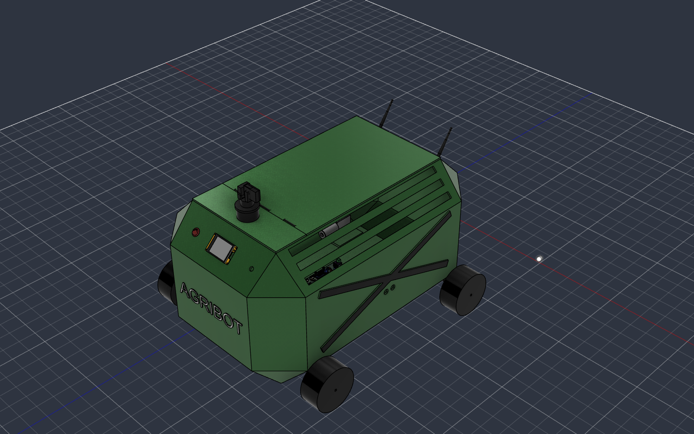
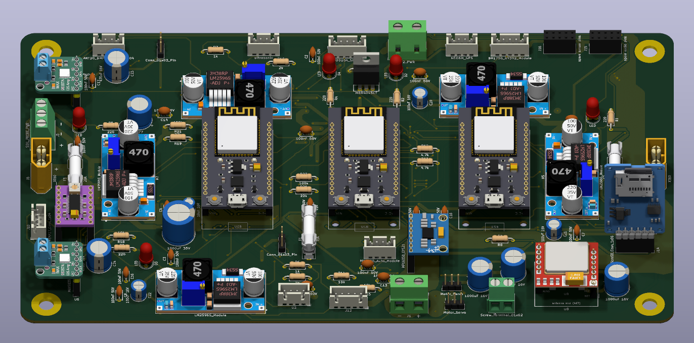
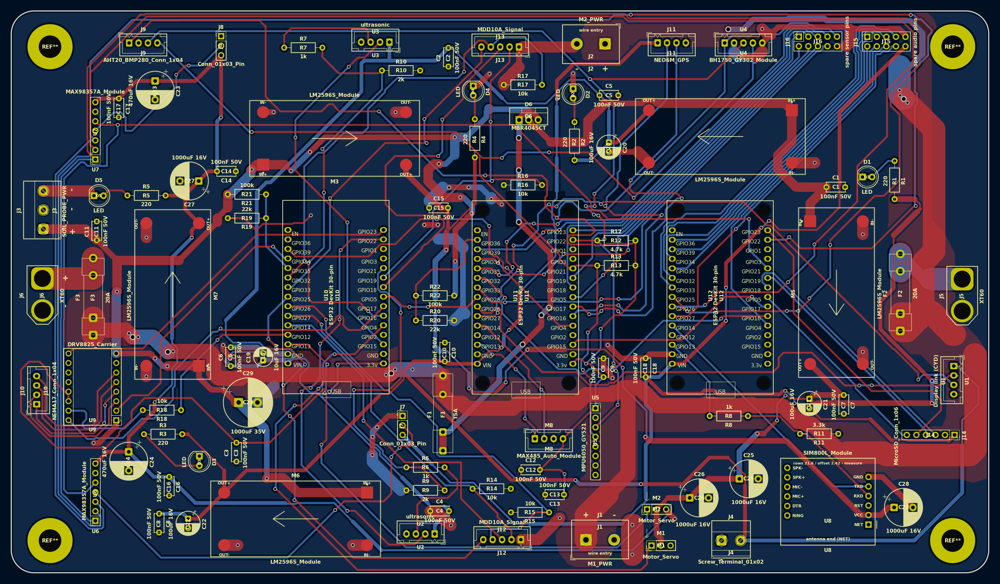
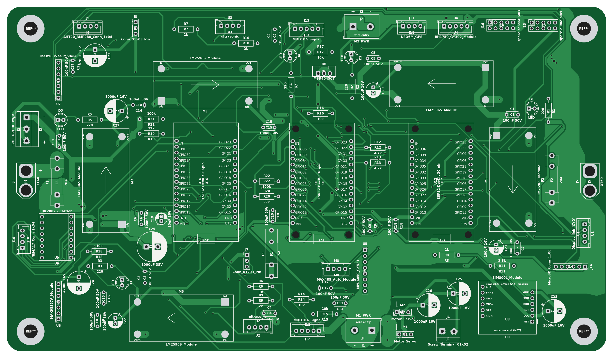
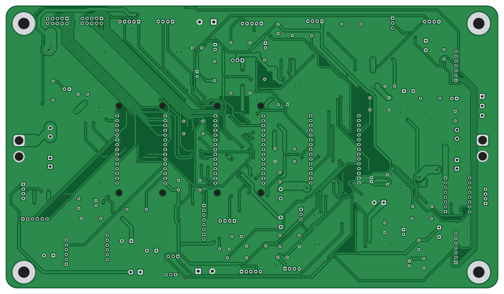
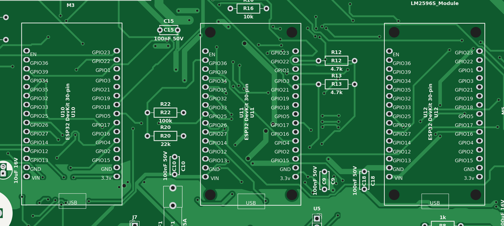
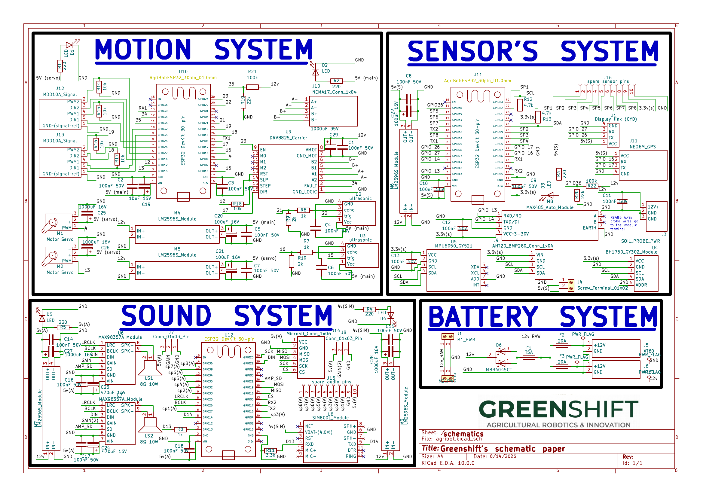
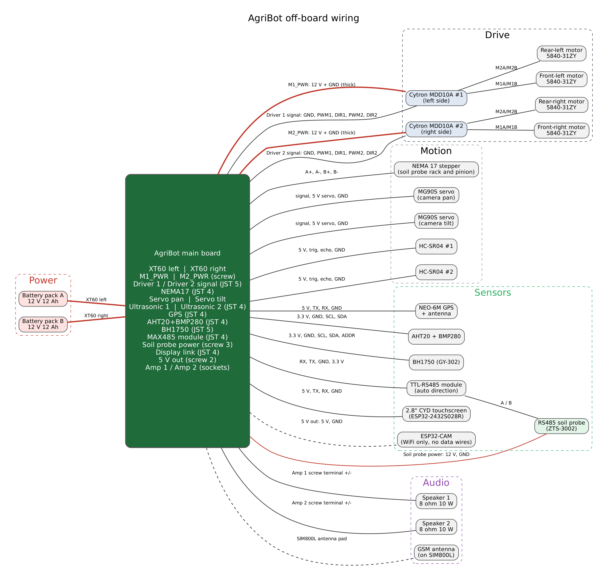

# The AgriBot rover

> **Stardance reviewers:** the part I'm submitting is the PCB, which is everything in `PCB/` and `production/`. I started AgriBot before I'd even heard of Hack Club, so the chassis, motors and the rest were already underway. They're here so you can see what the board plugs into, but please review the board on its own.

AgriBot tops out at 1.4 km/h, so you can outwalk it, and that's fine, because its job is to drive to a GPS point, stop, push a soil probe into the ground and read moisture, temperature, pH, salinity (EC) and NPK, then go do it again somewhere else.

This repo is the board that runs all of that: three ESP32s, five buck converters, the motor driver links, the stepper for the probe, GPS, a SIM800L and two speakers, on 260 x 150 mm of 2 oz copper.

## How it works

The idea is that nobody drives it most of the time. You give it a list of GPS points and it goes to each one, with two HC-SR04s up front so it doesn't drive into a tree. When it gets there it stops, and a NEMA 17 on a rack and pinion pushes the RS485 soil probe down. Sensors reads the probe and saves the numbers with the GPS position. While it's parked the ESP32-CAM can look at the crops, and if it's too far out for WiFi, the Audio ESP32 texts me through the SIM800L.

You can also drive it from your phone, mostly to get it to the field or out of a ditch. The phone joins the WiFi that Sensors puts up and sends throttle and steering about 20 times a second. Sensors passes that down a UART to Motion, and Motion turns it into left and right speeds for the two Cytron MDD10A drivers. Video goes straight from the ESP32-CAM to your phone over the same WiFi, and two servos aim the camera.

Motion only moves while Sensors keeps talking to it. If 150 ms go by without a command, the motors stop, and that's the entire safety system. Yes, I thought about a real e-stop. At walking pace you can just catch it, and pulling an XT60 kills everything.

Sensors also reads temperature, humidity, pressure, light and an MPU6050, and shows what's going on on a 2.8" Cheap Yellow Display over a 4-pin cable. Audio plays sounds off a microSD through two speakers.

## Why I made it

Salty soil is the big problem on small farms in Egypt, and checking a field means walking it with a probe or sending samples to a lab. I wanted a rover to do the walking. I also wanted every part to come from shops in Cairo. The board and everything that plugs into it, with the JLC order and shipping, comes to about $167. The whole rover is more like $560, and most of that is the four gearmotors (1,200 EGP each at Makers) and the soil probe (3,750 EGP). I didn't see that coming when I picked them.

I took AgriBot to RobotChallenge in Beijing this August and came 4th in FreeStyle Senior. After that I redid the electronics. The plan was three separate boards (Motion, Sensors, Audio) talking over ESP-NOW, and I didn't like the chip that drives the motors depending on radio, so now it's one board with the three ESP32s wired together over UART and Sensors in the middle. Before you ask why there are still three: I counted about 39 GPIOs for everything on here, and a DevKit gives you about 24 you can actually use.

## Pictures

These are renders of the real board file. The boards aren't ordered yet, so no photos.

### PCB layout
Red is top copper, blue is bottom. The big red areas are the 12 V pour and the bottom is almost all ground.

### Front and back

### The three ESP32s
Motion, Sensors and Audio, left to right. Sensors is the only one with its WiFi on.

### Schematic

Full-size PDF: [`production/schematic.pdf`](production/schematic.pdf)

### Wiring
Every cable that leaves the board. The numbers on the board map match the plug names underneath. Wire colours are only suggestions, so go by pin number (pin 1 is the marked end of each plug).

## What's on the board

**Power**
- 2x XT60 inputs, one per 12 V 12 Ah battery pack
- A 20 A fuse on each pack before they join, so a shorted pack can't get fed by the good one
- 2 screw terminals that send 12 V out to the motor drivers
- A 5 A fuse and an MBR4045CT Schottky in front of everything that isn't a motor
- 5x LM2596 buck modules: 5 V for each ESP32, 5 V just for the servos, and 4.0 V for the SIM800L. Every rail has its own LED so you can see when one dies
- Battery voltage sense on Motion and Sensors (100k/22k dividers)
- 12 V pour on top, ground pour on the bottom, 2 oz copper because up to 20 A comes through here

**Motion ESP32**
- Signal connectors for 2x Cytron MDD10A, which run four 5840-31ZY worm gearmotors
- DRV8825 for the NEMA 17 that lowers the soil probe
- 2 servo headers for the camera pan/tilt
- 2 HC-SR04 connectors, with dividers so the 5 V echo doesn't cook the ESP32

**Sensors ESP32**
- AHT20 + BMP280, BH1750 and MPU6050 on one I2C bus
- NEO-6M GPS
- MAX485 module for the RS485 soil probe, plus a 12 V terminal to power the probe
- Cable to the CYD touchscreen
- 8 spare pins on a header for whatever I forgot

**Audio ESP32**
- 2x MAX98357A amps on one shared I2S bus, gain picked with a jumper on each
- microSD
- SIM800L
- 8 more spare pins

## Stuff I'm not sure about yet

A lot of this board is educated guesses, and one guess already nearly went wrong. The first LM2596 footprint was mirrored, so 12 V would have gone straight into the output side of every buck. I only caught it when I swapped in real 3D models and the module didn't line up with its pads. The pads are now 4 mm squares that fit every clone I could find, but I still want to measure one.

- The probe is the part I'm least sure about. A NEMA 17 on a rack and pinion pushes maybe 20 to 50 N, and the rover can't push down harder than it weighs anyway. Soft or tilled soil should be fine. Dry, packed clay, I don't know yet.
- The 5 A fuse covers every buck plus the stepper. My estimate is around 4 A worst case from 12 V, and I haven't measured anything.

## If you build one

- Set every LM2596 to its voltage before it's connected to anything, then hot glue the trimmer. 12 V into a MAX98357A kills it instantly, and the SIM800L wants 4.0 V, not 5.
- Set the DRV8825 current limit before you plug the stepper in.
- Use ceramic 20 A fuses, not glass, and zip tie them down. The clips hold by friction and this thing shakes.
- The camera power terminal has ground on pin 1, the opposite of the other power terminals. It's marked − / + on the board, so look before you screw the wires in.
- Put some kapton tape under each buck module. They sit flat on the board and their bottom pins can scratch through the solder mask.

## AI declaration

Short version: the board is mine, and AI helped me check it.

I drew the schematic, picked every part, and did the placement and routing myself. I used AI kind of like a second pair of eyes. It helped me clear DRC errors and catch problems I missed, and it told me about parts I'd forgotten, mostly passives like decoupling caps, dividers and pull-ups. It also helped me plan which ESP32 pin goes where and what track width to use on the power paths. Some of the custom KiCad symbols and footprints were made by AI, and I checked those against the real modules before using them.

The firmware is where I needed AI the most. It's big, and there were errors I couldn't fix on my own, so AI helped write and debug parts of it, usually one small section at a time. I worked on it for weeks, but you'll only see one commit, because I pushed the wrong versions before and had to upload it all again. There are a lot of comments in the code. I know that can look like AI, but I put them there so you can follow what each part does.

## Files

- `production/` - what you send off to get one made: `gerbers.zip` (Gerbers + drill files), `schematic.pdf` and a copy of the firmware
- `production/printables/` - STEP files for the 3D-printed parts: the four motor mounts and the ESP32-CAM pan/tilt
- `PCB/` - KiCad 10 project (`agribot.kicad_sch`, `agribot.kicad_pcb`, `agribot.kicad_pro`, custom footprints, symbols and 3D models)
- `CAD/agribot-pcb.step` - STEP of the assembled board with every module on it. It's 54 MB, which the GitHub website won't take, so I pushed it with git instead. The module models are real ones (Espressif, KiCad library, Sector7GP, a SIM800L repo, openbikesensor, and the JLCEDA/EasyEDA Official Library for the fuses and the KF128 terminals), credits are in `PCB/libraries/3dmodels/CREDITS.md`
- `CAD/agribot-full-assembly.step` - the whole rover exported from my Fusion file (agribot v15): the plywood chassis with everything mounted on it, including the CYD. 32 MB, so this one went up with git too. Open it if you want to see how it all fits before cutting any wood
- `firmware/` - code for all 5 chips: the Motion, Sensors and Audio ESP32s, the CYD and the ESP32-CAM. How to flash and test it is in `firmware/README.md`
- `BOM.csv` - the bare board: everything on the PCB or plugged into it, from Makers Electronics, Micro Ohm and Free Electronics, with links, USD and EGP prices, shipping, and the JLC quote I got on Nov 3 ($68.80 for 5 boards in 2 oz copper). About $167. The drivers, motors, batteries, probe and chassis aren't in it, since they're not part of the board
- `BOM/AgriBot_Entire_Project_Cost.xlsx` - the whole rover, board plus everything else (motors, drivers, batteries, probe, CYD, camera, chassis, screws). The totals work themselves out, and if you change the EGP rate at the top all the USD numbers change with it
